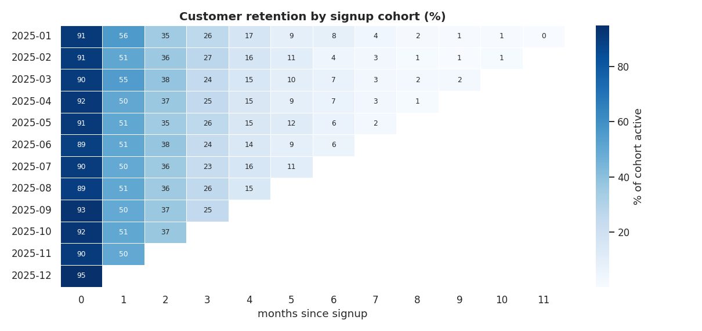
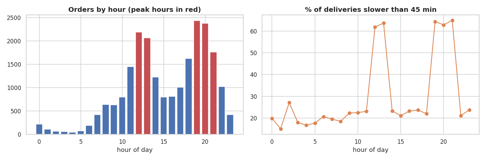

# 🍔 Food Delivery Analytics with SQL

   

> **10 production-style SQL queries answering growth, operations and retention questions for a food-delivery startup (22k orders, 6 cities).**
> 📓 **[Open the notebook](notebooks/02_food_delivery_sql_analysis.ipynb)** · 📁 **[Browse the SQL files](sql/)**

## 🎯 Business problem
A food-delivery startup wants to understand growth, delivery performance, customer retention and marketing efficiency.
All analysis is written in **SQL**; Python is only used to execute queries and plot results.

## 🗄️ Database schema
```
customers (customer_id PK, signup_date, city, acquisition_channel)
     │ 1
     │
     ∞
orders (order_id PK, customer_id FK, restaurant_id FK, order_ts, order_value, discount_amount,
        delivery_fee, payment_mode, status, delivery_minutes)
     ∞
     │
     │ 1
restaurants (restaurant_id PK, restaurant_name, city, cuisine, rating, is_cloud_kitchen)
```

## 🧠 SQL skills demonstrated (one query each)
| Query | Business question | SQL concepts |
|---|---|---|
| [01_monthly_kpis](sql/01_monthly_kpis.sql) | GMV, AOV, cancellation rate, MoM growth | CTE, conditional aggregation, `LAG()`, running total |
| [02_top_restaurants_per_city](sql/02_top_restaurants_per_city.sql) | Top 3 restaurants in each city | `RANK() OVER (PARTITION BY …)`, JOIN |
| [03_peak_hours](sql/03_peak_hours_and_delivery_time.sql) | When is demand highest and service slowest? | `strftime`, window `SUM() OVER ()` |
| [04_delivery_sla_by_city](sql/04_delivery_sla_by_city.sql) | Median & P90 delivery time by city | `ROW_NUMBER()`, percentile built manually |
| [05_cohort_retention](sql/05_cohort_retention.sql) | % of each signup cohort that returns | multi-step CTEs, date arithmetic |
| [06_acquisition_channel_quality](sql/06_acquisition_channel_quality.sql) | Which channel brings the best customers? | `LEFT JOIN`, aggregate of aggregates |
| [07_customer_value_tiers](sql/07_customer_value_tiers.sql) | Revenue concentration by decile | `NTILE()`, cumulative window sums |
| [08_discount_effectiveness](sql/08_discount_effectiveness.sql) | Do discounts increase basket size? | `CASE` bucketing |
| [09_cuisine_performance](sql/09_cuisine_performance.sql) | Which cuisines perform best? | `GROUP BY … HAVING`, share of total |
| [10_cloud_kitchen_vs_dine_in](sql/10_cloud_kitchen_vs_dine_in.sql) | Are cloud kitchens faster? | multi-table JOIN, group comparison |

## 📊 Key findings
- **Growth:** net GMV grew from ₹3.4 L (Jan) to ₹18.1 L (Dec) while average order value stayed flat at ~₹700, so growth is volume-driven.
- **Peak-hour strain:** 12-14h and 19-22h carry 48% of orders, and deliveries are ~7 minutes slower (47.9 vs 41.0 min).
- **City gap:** Bengaluru averages 48 min per delivery (P90 = 57) vs 37 min in Meerut.
- **Retention:** only ~51% of a signup cohort orders again in the next month, and ~36% two months later.
- **Channels:** referral customers are worth ₹3,108 on average vs ₹1,659 for influencer-acquired customers.
- **Concentration:** the top 10% of customers generate 33% of revenue.
- **Discounts:** ₹13 L of discounts given, yet average order value is flat (₹697 with no discount vs ₹706 at 21%+).
- **Cloud kitchens:** 41 vs 46 min delivery time and 6.0% vs 7.5% cancellations.




## 💡 Recommendations
Add rider capacity at peak hours · prioritise supply in Bengaluru/Mumbai · trigger a second-order offer inside the first week ·
shift marketing budget toward referrals · replace blanket discounts with targeted first-order offers · expand cloud-kitchen supply.

## 🗂️ Project structure
```
├── data/food_delivery.db            # SQLite database (customers, restaurants, orders)
├── sql/                             # the 10 analysis queries, one file each
├── notebooks/02_food_delivery_sql_analysis.ipynb
├── images/
├── src/generate_data.py             # rebuilds the database from scratch (seeded)
└── requirements.txt
```

## ▶️ Run it yourself
```bash
git clone https://github.com/singhji777/food-delivery-sql-analytics.git
cd food-delivery-sql-analytics
pip install -r requirements.txt
python src/generate_data.py                       # optional: rebuild the database
sqlite3 data/food_delivery.db < sql/01_monthly_kpis.sql   # or run any query in DB Browser for SQLite
jupyter notebook notebooks/02_food_delivery_sql_analysis.ipynb
```

## ⚠️ Data note & limitations
Data is **synthetic** (seeded generator in `src/`). There is no cost or CAC data, so profitability and channel ROI can't be computed, and
correlations (e.g. discounts vs basket size) are not causal - an A/B test would be needed (see my [A/B testing project](../03-ab-test-checkout-redesign)).

## 👤 Author
**Aditya Singh** · [GitHub](https://github.com/singhji777)
